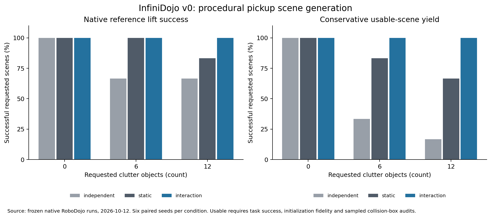

# InfiniDojo

Task-conditioned procedural scene generation for robot manipulation evaluation,
built on **Infinigen** and **RoboDojo**.

## Research direction

InfiniDojo aims to generate RoboDojo evaluation episodes with customizable scene
complexity. A minimal task scene and reference interaction guide procedural
scene completion, so requested variations can preserve a physically executable
task. The two components below describe the research direction; the implemented
v0 scope is listed separately.

1. An LLM agent translates scene descriptions and a supported RoboDojo task
   contract into procedural constraints and interaction events. Structured
   generation feedback drives bounded refinement.
2. An interaction-centric generator coordinates procedural assets and scene
   layouts with event-conditioned robot–object motion. Grasp establishment,
   lift-off, and release change the constraints between bodies. Robot links
   remain articulated; only a stable grasp permits a fixed hand–object transform.

Reference motions are internal generation and validation tools. Evaluated
policies remain free to choose their own actions. Failure diagnosis and RSI
evaluation are downstream applications, not the core method.

## Next stage — planned

The [paper scope and stopping contract / 投稿版本约定](docs/paper-contract.md)
fixes the main claim, finite scope and evidence requirements. The
[next-stage work plan / 下一阶段任务](docs/next-stage.md) defines the event and
cluster representation, a complete pick–transport–place cycle, strong generation
baselines, independent validation, milestones and completion criteria. It also
plans to evaluate **OpenWAM** and XPolicyLab's **GPT_6_Astra_Direct_EEF** on both
native RoboDojo instances and InfiniDojo-generated instances. Neither has been
evaluated on this repository's generated episodes yet.

The main claim to establish is a controllable generation workflow that produces
physically validated, runnable manipulation evaluation episodes. Generation
baselines and ablations explain the role of event/cluster constraints; higher
throughput than other generators is a secondary hypothesis, not the central claim.
Development has started with explicit event/support transitions and a native
full-stack reference runner. The plan is not a completed implementation or a
new held-out experimental result.
See the [development notes and reproduction commands](docs/development.md).

## Initial implementation scope

The first experiment targets RoboDojo's `general_pickup` task: physically grasp
and lift a procedurally generated rigid object by more than 10 cm. The native
task predicate is retained. This is a benchmark extension, not an official
RoboDojo leaderboard run.

The v0 prototype includes real Infinigen can meshes, a live structured LLM
compiler with validator feedback, three matched layout generators, native
RoboDojo reference execution, and independent collision-box audits.

The [first quantitative study](results/v0-pilot/README.md) is complete: all 54
held-out scene requests were physically executed. Native lift success was
14/18 (independent), 17/18 (static), and 18/18 (interaction). Conservative usable
scene yield was 9/18, 15/18, and 18/18, respectively. These are small controlled
in-house baselines, not reproduced results from other papers or VLA scores.

See [running the prototype](docs/running.md) and
[research positioning](docs/research-positioning.md).

v0 conditions clutter placement on a validated reference interaction. It does
not yet jointly optimize arbitrary manipulation trajectories and scenes. Its
LLM feedback checks supported task/scene constraints. The asset family, task
and event vocabulary are deliberately small; release/placement tasks are future
extensions. USD exports use a preview material, not baked photoreal shaders.

See [evaluation protocol](docs/evaluation.md) and
[dependency provenance](docs/dependencies.md). Runtime assets, environments,
credentials, and large videos are excluded from Git.
