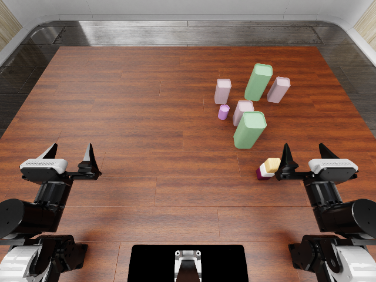

# Complete interaction → Infinigen clutter → validated episode

Date: 2026-10-12. **Adaptive development evidence, not a held-out comparison.**

G2 now completes a native `stack_blocks` reference with real Infinigen can
assets. The three asset settings use seeds 1200/1201/1202, nominal radii
0.018/0.025/0.032 m and heights 0.05/0.09/0.13 m. Their procedural shapes include
circle and rectangle variants; geometry is regenerated, not uniformly scaled.
Materials remain simple USD preview materials.

The request fixes six or twelve clutter objects in XY region
`[[0.10, -0.30], [0.48, 0.18]]`, 5 mm clearance and three or six pairs with
90 mm centre spacing. Pair members move together during layout sampling.
Every measured robot-link and task-object pose is reserved, including released
objects, the second transfer and robot return. This is a fixed-reference
baseline, not yet G3 interaction/scene joint refinement.

## Observations

- Two six-object layouts completed the physical reference and passed all
  **24 development checks**. One used initial greedy packing; the other used
  bounded restarts to avoid being trapped by early placements.
- Twelve-object requests exhausted the 1,000-proposal budget. Reusing the
  other existing reference also failed. A separate 10,000-proposal search
  diagnostic still failed. No failed request was shortened to ten objects.
  These observations do not prove geometric impossibility or necessity of G3.
- A deliberately overlapping initialization still scored **100** on native
  stack success. It was rejected for translation/rotation drift, clearance,
  pair-relation mismatch and the independent geometry screen. This is a
  validator diagnostic, not a naturally generated benchmark sample.
- A validated episode was exported, copied to another directory and reloaded.
  Its complete physical reference and all development checks passed again.
  The bundle contains relative asset paths and content hashes, and excludes
  reference controls, trajectories and interaction annotations.

All seven generator invocations are listed in [generation_rows.json](generation_rows.json),
including the higher-budget diagnostic and a byte-identical layout reproduction.
All four physical executions are listed in [execution_rows.json](execution_rows.json).
They cover two generated layouts, an injected invalid variant and a relocated
copy; they are not four independent evaluation samples. No policy was tested.

## Verification scope

The validator owns the permitted task contact contract; it does not accept a
generator's widened contact set. It combines unchanged native task success,
actual PhysX reports, initialization fidelity, requested footprint/clearance
and pair relations, actual holding transforms, release/support and final
translation/rotation stability. An independent OBB screen reads robot geometry
from the native USD and uses observed clutter/robot/task-object poses.

[Thresholds](thresholds.json) are explicit development values. Contact reports
are collected at 4 ms and state samples at 20 ms. OBB overlap can be a false
positive; sampled checks do not prove continuous collision freedom. Initial
settling is assessed by pose preservation and geometry, and the fixed base
block's table support uses geometry because it may already be asleep when
recording begins. Full threshold calibration and broader task coverage remain
unfinished.

## Reproduction and artifacts

Commands are in [the development guide](../../docs/development.md). The current
default uses 128 proposals per cluster before restarting within the total
budget. `--cluster-budget 1000` reproduces the original six-object greedy layout
byte-for-byte with the same inputs; the final verification command checked this.

Each execution folder here includes its result, actual source hashes, object
metadata and a compact validation report. Contact-step lists are reduced to
counts and endpoints in the compact report; raw-file hashes identify full
local artifacts in `outputs/v1-development/`. The validator has its own source
hash because it is run independently after execution. Source snapshots are
retained for simulator runs and later generation invocations.

[episode-manifest.json](episode-manifest.json) describes the locally exported
bundle; the runtime asset files are not included in this results folder. The
native RoboDojo assets must be installed separately. This is not yet the public
instance release or the OpenWAM/GPT-6 Astra evaluation.
