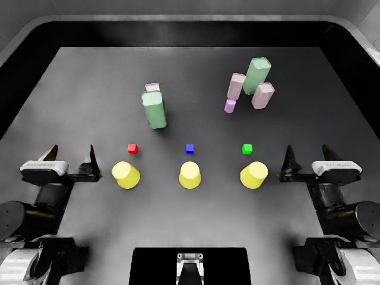

# 完整覆盖与揭开：开发证据

日期：2026-10-13。这是原生 `cover_blocks` layout 0 的开发接入验证，
不是冻结的批量有效率、生成方法优势或策略成绩。数值与证据哈希见 [summary.json](summary.json)。

## 方法与原生任务

保持三只原生倒扣杯、三个方块、原始质量/摩擦与成功条件。
现有 CuRobo 参考控制器完成六次真实抓取和搬运：按初始左右顺序覆盖，
再按红、绿、蓝揭开，最后双臂返回。layout 0 的覆盖颜色顺序为红、蓝、绿。
执行期间不焊接或瞬移物体，参考动作不提供给被测策略。

这项任务补充了已有拾取/堆叠表示的一个区别：杯子搬运前后都由桌面支撑，
但与方块的覆盖关系发生变化。覆盖不意味着杯子由方块支撑，也不许可杯壁穿入方块。
沿用同一 event 表示与 G2 完整运动空间补全；没有增加新规划器或独立优化模块。
动作规划的初始参考仍使用原生桌面碰撞世界，最终接触证据另行审计。

生成请求固定六个真实 Infinigen 杂物、三对 9 cm 间距，区域为
`[-0.35, -0.28]` 至 `[0.35, 0.22]` m，间隙要求 3 mm。
输入见 [开发约定](../../specs/v1-cover-development.json) 和
[结构化请求](../../specs/requests/cover-paired-6.json)。



## 本次结果

- 首次完整参考：六阶段通过，15,504 个物理步，约 460.94 秒；方块最大位移约 0.00255 mm。
- G2：8 次局部放置尝试完成六杂物请求，几何采样约 0.165 秒，保留全部三对关系。
- 加入杂物后的完整物理重放：原生任务成功，约 456.13 秒，29 项开发检查全部通过。
  六个搬运结束状态共检查 54 个杯—方块组合；没有源网格相交或违规接触记录。
- 原有堆叠和拾取记录重新验证，分别仍通过 24 项和 26 项检查。
- 导出后复制到新目录，实际重新加载六个资产并重放完整操作，再次通过 29 项检查。
  此次关闭视频编码，耗时约 310.25 秒；不与含视频的运行时间直接比较效率。

以上是一个场景族的开发证据；参考重放不算独立生成样本，不据此估计总体有效率。
两次物理执行属于同一个生成实例，重载结果在汇总中另列。代码检查及 55 项测试通过。

## 独立验证

原生外部包围轮廓的覆盖判定保持不变；额外检查使用实际杯子碰撞源网格，
对每次搬运结束时的全部杯—方块组合做整个方块体积的相交检查，并核对覆盖/揭开关系。
检查结合三角形与盒子的分离轴测试、实体内部判定，不能只看方块中心或几个角点。
逐物理步的 PhysX 接触记录继续检查非法接触与穿透，原有请求、稳定性和夹持关系检查保留。

原生杯保留 `convexDecomposition`；没有换成实心盒子或单一凸包。
杯子源网格的包围范围与元数据存在约 2 mm 偏移，因此空间预留和支撑检查使用源几何范围。
网格查询将顶点与查询点一同转换成毫米，避免细小三角形被射线查询的数值容差漏过；
原生杯腔、杯底实体与杯外三处查询分别得到空、实、空。

源网格检查不是 PhysX 烹制后的凸分解检查，六个离散结束状态也不证明连续无碰撞。
两者与实际物理接触证据一起作为明确范围内的开发接受条件；阈值尚未正式冻结。
杯子资产在执行时记录内容哈希，验证时重新核对，缺失或不一致不得导出。
最初参考执行尚未记录这一新增哈希文件，因此只作为参考与诊断证据，不能据此单独导出实例。

## 复现

使用固定版本的 RoboDojo 和已有三个 Infinigen 资产，另安装 `.[validation]` 可选依赖。
`SIM_PYTHON` 指向 Isaac Python；按现有运行说明配置许可环境变量、`LD_PRELOAD` 与
`PYTHONPATH="$PWD/src"`。以下输出目录须不存在。

```bash
PYTHONPATH="$PWD/src" "$SIM_PYTHON" -m infinidojo.native_cover \
  --robodojo-root "$ROBODOJO_ROOT" --seed 1200 --max-steps 20000 \
  --output outputs/cover-reproduction/reference --headless --enable_cameras

PYTHONPATH="$PWD/src" .venv/bin/python -m infinidojo.completion \
  --robodojo-root "$ROBODOJO_ROOT" --reference outputs/cover-reproduction/reference \
  --assets outputs/v1-development/assets/1200 outputs/v1-development/assets/1201 outputs/v1-development/assets/1202 \
  --request specs/requests/cover-paired-6.json \
  --output outputs/cover-reproduction/generated --seed 1200 --attempt-budget 1000

PYTHONPATH="$PWD/src" "$SIM_PYTHON" -m infinidojo.native_cover \
  --robodojo-root "$ROBODOJO_ROOT" --seed 1200 --max-steps 20000 \
  --layout outputs/cover-reproduction/generated/layout.json \
  --asset-map outputs/cover-reproduction/generated/asset-map.json \
  --reference outputs/cover-reproduction/reference \
  --output outputs/cover-reproduction/execution --headless --enable_cameras

PYTHONPATH="$PWD/src" .venv/bin/python -m infinidojo.validation \
  --robodojo-root "$ROBODOJO_ROOT" --execution outputs/cover-reproduction/execution \
  --generation outputs/cover-reproduction/generated --output outputs/cover-reproduction/validation.json

PYTHONPATH="$PWD/src" .venv/bin/python -m infinidojo.episode \
  --execution outputs/cover-reproduction/execution --generation outputs/cover-reproduction/generated \
  --validation outputs/cover-reproduction/validation.json --output outputs/cover-reproduction/episode
```

重新加载使用 `infinidojo.native_cover --episode /absolute/path/to/episode`，
参考动作仍由 bundle 外部的 `--reference` 单独提供。
本次参考预算为 20,000 原始物理步，原生策略预算为 800 次动作，两者分别记录；
参考结果不是官方策略评分或原生预算内性能证明。几何布局耗时也不代表端到端生成成本。

## 未完成项

覆盖任务的语言入口、支持杯腔与双臂的场景感知 G1/G3、更多初始布局、正式实验和策略执行尚未完成。
`--scene-aware` 对覆盖任务明确拒绝，不会用实心杯近似冒充杯腔规划。
策略入口已接受该任务并核对配置路由；尚无覆盖任务的 OpenWAM/Astra 成绩。
