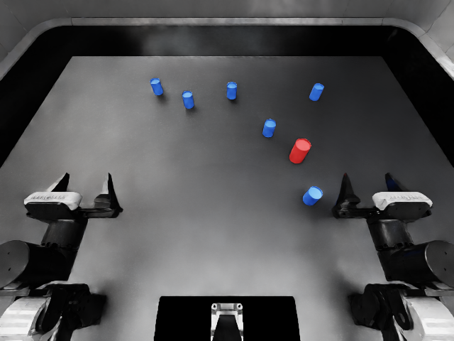
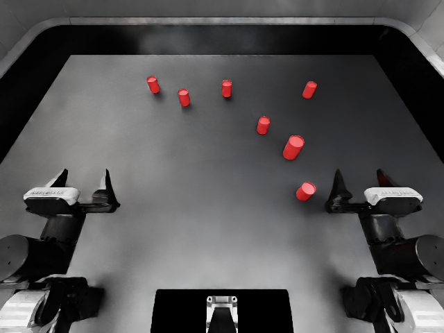

# 自然语言到 RoboDojo 评测实例：v2 路线开发

2026-10-13。开发接入，不是正式论文有效率或策略优劣实验。
条件在运行前写入 [开发清单](../../specs/language/scene-route-development.json)。
使用统一 `scene-v2` 编译与 `infinidojo.route` 入口，未启用 G3。

## 已完成的语言与生成检查

- 九条真实 `gpt-6-sol` 调用：七条支持的请求均一次编译正确，两条不支持的请求正确拒绝。
  [逐条结果](language-summary.json)、[实际用量与调用证据哈希](language-usage.json)均保留。
  正确答案在编译后核对，未进入模型提示或反馈；没有迭代改进收益结论。
- 拾取的基准、外观、关系、数量和联合变化五种条件均已物理执行、接受并导出。
- 完整三方块堆叠及返回已执行、接受并导出。
- 完整覆盖/揭开流程正在运行；原生策略评测器的真实模型接入检查尚未运行。
  未完成项目不计作成功，见 [生成状态](generation-summary.json)。

拾取五种条件共享场景种子 1204，另两个任务分别使用 1205、1206。
这是七个预先声明条件、三个基础场景族，不是七个独立统计样本。
每个新请求先创建自己的真实 Infinigen 资产，再获取对应任务的完整参考，
在满足请求关系和参考运动空间的条件下补全场景，最后执行并导出 episode。
物理执行用于检验生成是否兑现可用性，不构成新的验证算法或形式物理保证。

## 三种可控变化

基准为红色圆罐目标、六个蓝色小圆罐干扰物。外观条件只将干扰物改为红色；
关系条件要求两两成对并满足目标初始中心的相对区域；组合条件增至十二个干扰物；
联合条件同时施加上述变化。目标与干扰物保持高度差，原生目标描述包含颜色、形状和尺寸。

[外观配对检查](appearance-pair-check.json)确认：网格顶点和面、物理元数据、最终布局、
完整参考控制及轨迹均相同，材质颜色改变。不是通过改变物体几何或轨迹制造外观条件差异。

外观目前限于简单材质的具名颜色，组合限于干扰物数量及单种罐体规格，
关系限于成对距离与区域约束；不宣称纹理、任意资产类别、任意任务或相机视角控制。
完整轨迹补全仍是核心实现，不因附加 event 名称就主张新的 cluster 优化算法。

## 复现与成本

运行方式见 [统一语言入口](../../docs/language-frontend.md)。第一条基准通过
`--description` 一条命令完成；其余条件先完成真实语言编译，再以 `--compiled` 继续。
编译文件与原生模板均复核哈希。每次执行的源文件哈希保留在各自 `route.json`。

直接语言入口的耗时包含语言、资产生成、参考、补全、执行与导出。
使用既有编译的路线耗时不含此前语言调用，其成本在语言记录中单列，不能直接混比。
各完整路线预算为 1800 秒，最多四次布局尝试、4000 次局部放置提案；不为失败增加预算。
参考执行的物理步数与原生策略动作预算分开，不能将参考成功作为被测策略成绩。
