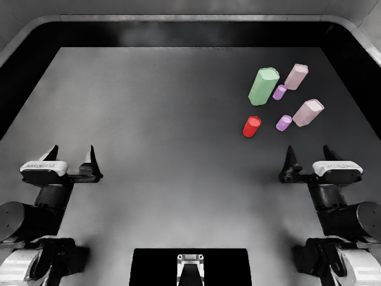
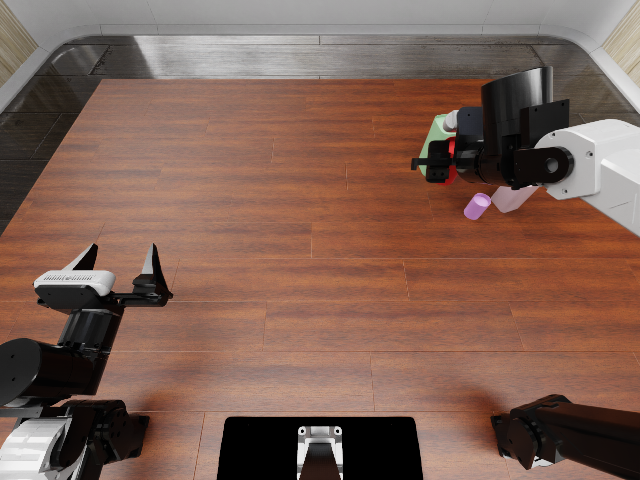

# v2 技术路线：程序化物体成为操作目标

2026-10-13。首个集成实例，条件在运行前写入
[开发约定](../../specs/v2-route-development.json)。不是正式论文实验或策略成绩。

Infinigen CanFactory 生成红色圆罐作为 `general_pickup` 的实际目标：
半径参数 2.2 cm、高度 7 cm、位置 `(0.22, -0.05)` m、种子 1203。
实际模型横向范围为 ±2.2022 cm；物理质量 0.08 kg，闭合罐体使用凸包碰撞。
颜色为明确请求的 USD PreviewSurface，未烘焙 Infinigen 原始程序化材质。

首先在该目标几何上规划并真实执行完整拾取，随后补全六个 Infinigen 干扰物，
三对物体的对内距离均为 9 cm。生成器保留完整机械臂和目标运动空间。
无 G3 修复、焊接、目标瞬移或用原生罐体替代生成目标。

- 第一个完整布局通过；局部放置提案 31 次，总流程约 94.55 秒。
- 原生拾取成功，抬升约 14.994 cm，持续持物 1 秒。
- [物理与请求检查](validation.json)全部 27 项通过。
- episode 包含目标及杂物的四个程序化资产，可移至另一目录。
- [独立重载回放](relocated-result.json)再次成功，27 项检查全部通过。
  [资产解析记录](relocation-check.json)确认四个资产均来自复制后的 episode。

以上是**一个生成实例及其重载复核**，不能算作两个独立样本，也不能证明更广尺寸范围可抓取。
94.55 秒不包含资产创建；记录保留这一成本边界，不作为生成效率优势。

## 接通的接口

- `assets.generate_can` 支持具名颜色与圆形/圆角方形选项，保留实际几何、参数及内容哈希。
- `assets.pickup_layout` 用生成目标建立最小任务场景；原生模板杂物由请求中的新杂物替换。
- `request_run --task-assets` 将任务资产传入新参考的规划和执行。
- 场景补全读取参考的生成资产映射，不再只去原生资产目录查找操作目标。
- 目标与杂物的资产映射一起导出；同一 ID 对应不同资产会拒绝，避免覆盖目标。
- 原生指令仍通过 `<target>` 解析生成物体描述，原生抬升判据保持不变。

首次预检暴露了原生布局含无标签杂物的适配问题，尚未启动仿真；
[错误记录](preflight-error.json)保留。修正后仍使用原声明的目标、位置与条件，未更换种子。
执行版本由 [run.json](run.json) 中全部源文件哈希标识；原始轨迹、控制和接触记录的
哈希及大小见 [raw-artifacts.json](raw-artifacts.json)。不在 Git 中复制原生授权资产。

## 后续范围

此结果打通程序化操作目标的物理生成、导出和重载。
三个任务的统一语言入口、三种复杂度的请求控制，以及新请求经语言编译后完整运行仍待完成。
没有新 cluster 优化或修复优势结论；G3 不继续扩展。
